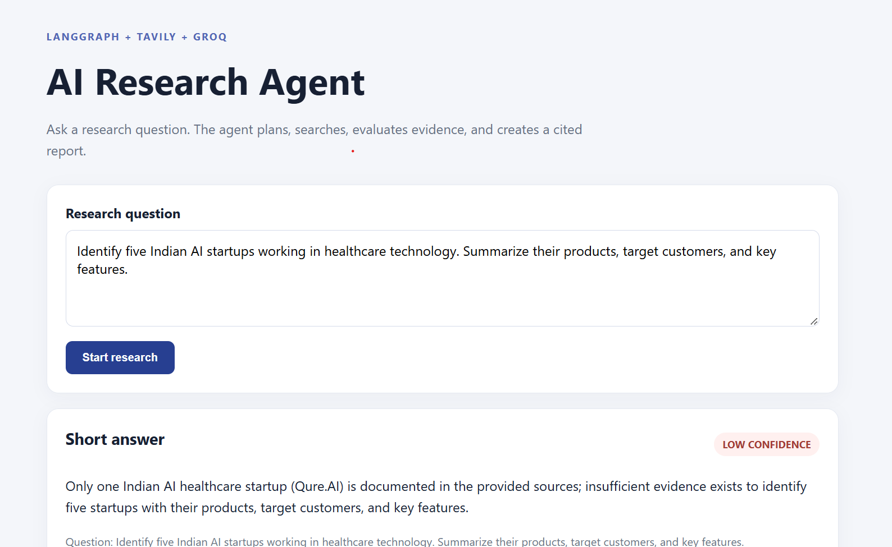
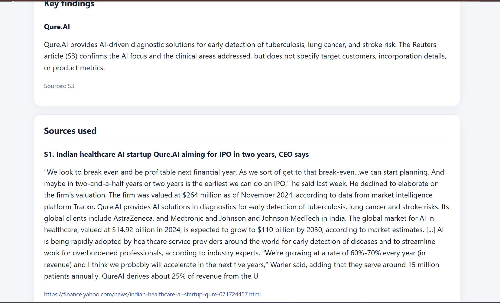
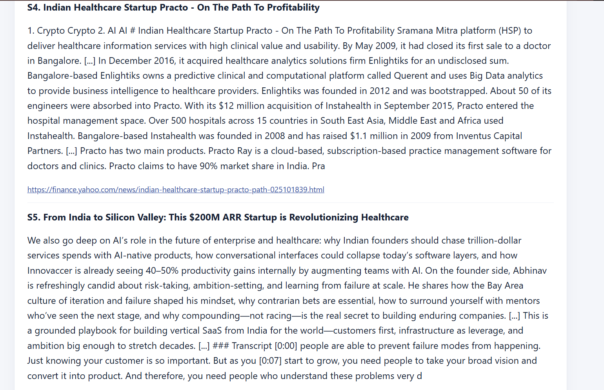
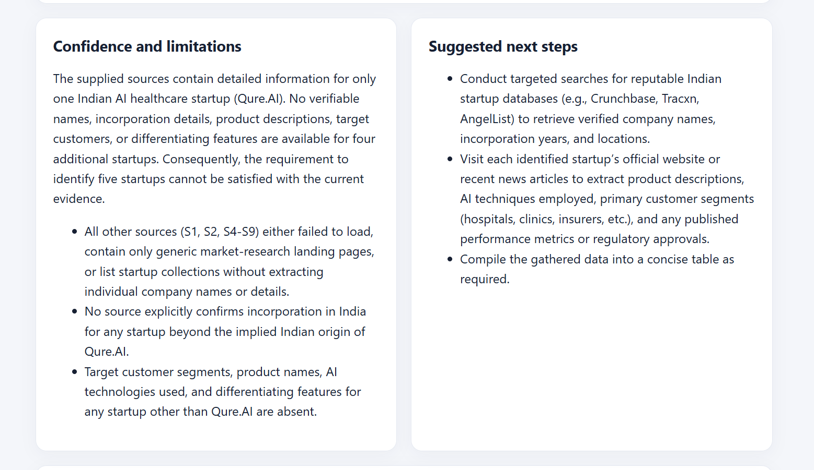
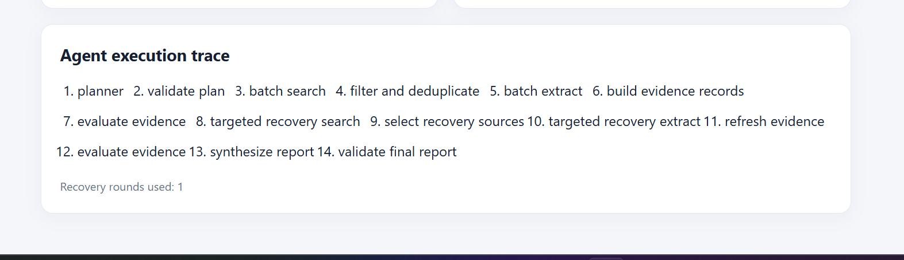

# AI Research Agent — Sample Output

## Test Case: Indian AI Healthcare Startups

### 1. Research Question

> Identify five Indian AI startups working in healthcare technology. Summarize their products, target customers, and key features.

### 2. Purpose of This Test

This test evaluates whether the AI Research Agent can discover relevant companies, gather company-level information, identify missing evidence, perform targeted recovery, and communicate uncertainty rather than inventing unsupported details.

### 3. Generated Result

**Short answer:** The agent reported that only one Indian AI healthcare startup (Qure.AI) was sufficiently documented in the retrieved sources. It stated that the available evidence was insufficient to identify five startups with their products, target customers, and key features.

**Confidence:** Low confidence.

**Key finding — Qure.AI:** The report described Qure.AI as providing AI-driven diagnostic solutions for early detection of tuberculosis, lung cancer, and stroke risk. The report attributed this information to source S3.

**Evidence limitation:** Although the search returned several sources about the Indian healthcare and health-tech market, the report found that the sources did not provide verifiable company names and the required company-level details for five startups.

### 4. Sources Retrieved

The application displayed nine source entries (S1–S9). The visible source list included:
- A Reuters article about Qure.AI.
- An Indian healthcare market report.
- Articles and pages about Indian healthcare startups and health-tech companies.
- A LinkedIn post and other general market or startup listings.

The report noted that several retrieved sources failed to provide sufficiently specific evidence about individual companies, products, target customers, or differentiating features.

### 5. Confidence and Limitations Reported by the Agent

The agent concluded that the requested list of five startups could not be supported by the retrieved evidence.

It specifically reported:
- Only Qure.AI had sufficiently detailed company-level information.
- Several other sources contained general market information, startup lists, or content that did not establish the required details.
- The available sources did not explicitly confirm the Indian incorporation of additional startups.
- Product names, AI technologies, target customer segments, and differentiating features for four additional startups were unavailable in the retrieved evidence.

### 6. Suggested Next Steps

The agent recommended:
1. Conduct targeted searches in reputable Indian startup databases such as Crunchbase, Tracxn, and AngelList to verify company names, incorporation years, and locations.
2. Visit each identified startup's official website or recent news articles to extract product descriptions, AI technologies, customer segments, and published performance metrics or regulatory approvals.
3. Compile the gathered data into a concise comparison table.

### 7. Agent Execution Trace

The application displayed the following execution stages:

1. Planner
2. Validate plan
3. Batch search
4. Filter and deduplicate
5. Batch extract
6. Build evidence records
7. Evaluate evidence
8. Targeted recovery search
9. Select recovery sources
10. Targeted recovery extract
11. Refresh evidence
12. Evaluate evidence
13. Synthesize report
14. Validate final report

**Recovery rounds used:** 1

### 8. Screenshots of Actual Application Output

Paste the screenshots from the application below, in the order they appear in your supplied PDF.

#### Screenshot 1 — Research question and short answer

<!-- Paste screenshot 1 here. -->

#### Screenshot 2 — Key findings and initial sources

<!-- Paste screenshot 2 here. -->

#### Screenshot 3 — Retrieved sources and source content

<!-- Paste screenshot 3 here. -->

#### Screenshot 4 — Additional retrieved sources

<!-- Paste screenshot 4 here. -->

#### Screenshot 5 — Confidence, limitations, and suggested next steps

<!-- Paste screenshot 5 here. -->

#### Screenshot 6 — Agent execution trace

<!-- Paste screenshot 6 here. -->

### 9. Evaluation Observation

**What worked well**
- The agent generated a research plan and executed the search and extraction workflow.
- It performed one targeted recovery round after evaluating the initial evidence.
- It did not fabricate four additional startup profiles when the retrieved evidence was insufficient.
- It returned a low-confidence result and explained the evidence gaps.
- It displayed the execution trace and recovery count.

**What did not work well**
- The agent did not find enough reliable company-level evidence to satisfy the request for five startups.
- Some retrieved sources were broad market reports, lists, or posts rather than direct evidence from individual startup websites.
- The extracted material included content that was not sufficiently useful for the requested company-by-company comparison.

**Overall observation**

This test demonstrates the agent's ability to recognize incomplete evidence and communicate limitations. It also reveals an area for improvement: more targeted company discovery and stronger source-quality filtering are needed to satisfy entity-discovery questions reliably.

---

**Note:** This document records the output shown in the supplied screenshots. The observations describe what the agent returned in this run; they are not an independent verification of the factual claims in the retrieved sources.
